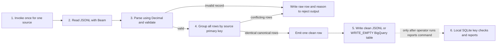
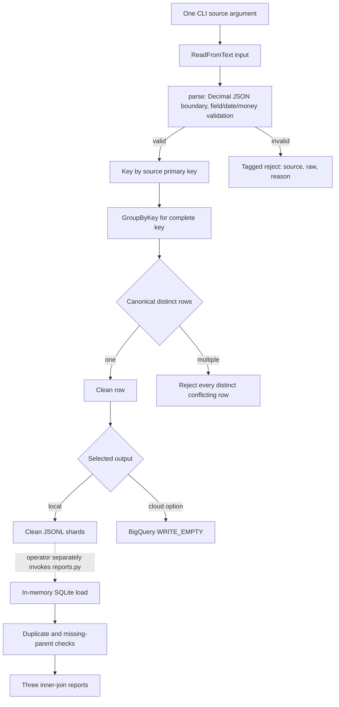
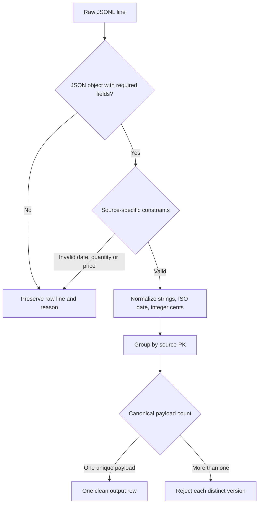
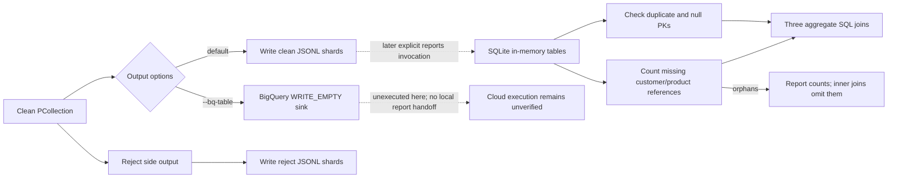
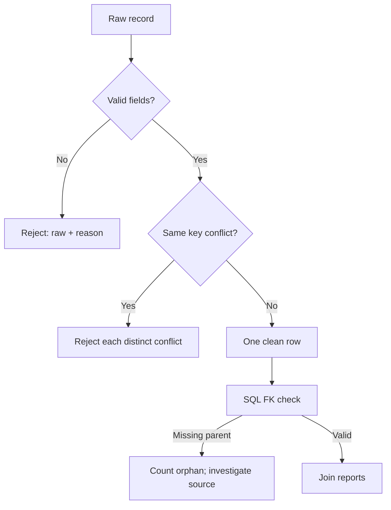
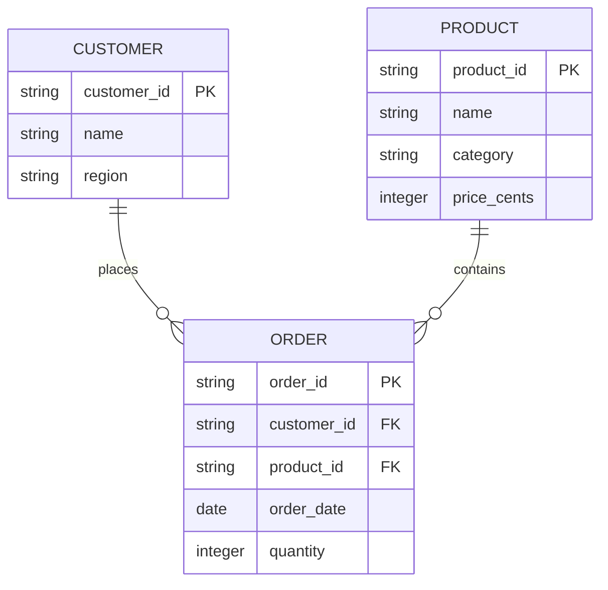

# Beam sales datamart

An independently written, synthetic-data exercise inspired by [UT Austin CS 327E Milestone 4](https://www.cs.utexas.edu/~scohen/cs327e_spr21/projects/Milestone4.pdf). It uses real Apache Beam transforms and DirectRunner locally. The three tiny JSONL fixtures are invented for this project; they do not represent real customers or transactions.

## Architecture and review walkthrough

Each CLI invocation builds a Beam graph for exactly one selected source. Orders, customers and products are invoked separately; `reports.py` is a later local command that reads their clean shards. There is no automatic arrow between source processes or between the optional BigQuery sink and local SQLite report loader. Cloud BigQuery SQL is separate and has not been executed.

### Subsystem: parse, deduplicate and reject

### Subsystem: storage selection, checks and recovery

| Step | Handoff and technique | Exact implementation |
| --- | --- | --- |
| 1. Invoke source graph | CLI requires one of `orders`, `customers`, `products` | [argument parser and graph](pipeline.py#L63) |
| 2. Read | Beam `ReadFromText` processes the selected path | [pipeline graph](pipeline.py#L71) |
| 3. Validate and normalize | JSON `parse_float=Decimal`; source fields, dates, quantity, price bounds | [parse](pipeline.py#L22) |
| 4. Resolve key | Group by the selected source's primary key; exact canonical duplicates collapse | [resolve](pipeline.py#L53), [GroupByKey graph](pipeline.py#L74) |
| 5. Route rejects | Invalid raw records and all distinct conflicting versions include reasons | [parse and resolve](pipeline.py#L22), [reject sink](pipeline.py#L77) |
| 6. Write clean output | Local clean JSONL by default; optional BigQuery sink refuses populated tables | [sink selection](pipeline.py#L79) |
| Cloud sink boundary | `--bq-table` selects BigQuery `WRITE_EMPTY`; staging and cloud execution remain unverified | [sink selection](pipeline.py#L79) |
| 7. Run reports explicitly | Later command loads all three clean sources into memory and computes checks/reports | [reports CLI](reports.py#L27) |

Technique: exact decimal parsing before integer cents

**How:** `json.loads(..., parse_float=Decimal)` preserves JSON decimal text as Decimal; product price is bounded to two fractional digits and converted to integer cents. Quantity and line-total arithmetic are checked against signed INT64 limits.

**Why:** binary float rounding must not silently change monetary cents.

**Alternative and tradeoff:** parsing through float is shorter but can round decimal values. SQLite report totals stay integers and fail on overflow; no currency conversion or fractional cents are supported.

Technique: conflict rejecting deterministic deduplication

**How:** rows are grouped by primary key, serialized with sorted keys, and deduplicated as exact canonical JSON. One distinct value emits one row; multiple values each go to rejects.

**Why:** Beam does not guarantee arrival order, so choosing the first conflicting record would make the output unstable.

**Alternative and tradeoff:** a trusted version timestamp could choose a winner, but fixtures do not define one. GroupByKey stores all values for a key, so a hot key consumes memory proportional to its records.

Technique: report key checks before inner joins

**How:** the reports command counts duplicate/null keys and missing parents, then runs three inner-join aggregates over the clean outputs.

**Why:** orphan rows are visible in checks even though they do not appear in joined reports.

**Alternative and tradeoff:** Beam-side joins would combine source runs into one graph. This project preserves the separate-source boundary; SQLite is in-memory and cloud SQL remains unexecuted.

## Run

1. Use Python 3.11: `python -m venv .venv`, then `.venv/Scripts/python -m pip install -r requirements-lock.txt` (Windows). The locked versions are platform-specific to this environment. See [Google's Python Dataflow guide](https://docs.cloud.google.com/dataflow/docs/guides/create-pipeline-python).
2. Run each source independently: `.venv/Scripts/python -m pipeline --source orders --input fixtures/orders.jsonl --output scratch/orders`. Repeat with `customers` and `products`, changing both paths. See [validation](#validation) and [deduplication](#deduplication); source: [pipeline.py](pipeline.py).
3. Run `.venv/Scripts/python -m reports scratch`. The fixture deliberately has one missing customer, so the key check reports it. Reports use inner joins and exclude orphan orders; inspect checks before interpreting totals. Amounts are integer cents; SQLite fails rather than silently returning an inexact amount when a line or sum exceeds signed INT64. See [SQL checks](#sql-checks) and [reports.py](reports.py).
4. For an authorized cloud environment, upload input files separately and invoke the same program with `--source orders --input gs://BUCKET/orders.jsonl --output gs://BUCKET/run/orders --bq-table PROJECT:DATASET.orders_Dataflow --runner DataflowRunner --project PROJECT --region REGION --temp_location gs://BUCKET/tmp --requirements_file requirements-cloud-lock.txt --setup_file setup.py --save_main_session`. Replace all placeholders and repeat per source. Beam's [BigQuery connector](https://beam.apache.org/documentation/io/built-in/google-bigquery/) provides the sink; `WRITE_EMPTY` refuses populated tables. Output prefix also receives reject files. The SDK contract test uses a local stand-in sink; Linux dependency installation, staging and cloud execution remain unverified.

## Techniques

Validation and normalization — step 2

Required fields are checked; dates become ISO dates, product prices become integer cents and quantities become integers. Numeric JSON prices are decoded directly as decimal values before conversion, avoiding binary floating-point rounding. Invalid JSON and invalid values go to a side output with original input and reason. This keeps the rest usable and makes failures inspectable. Alternative: fail the whole batch for strict ingestion, at the cost of availability. Arbitrary extra fields are ignored. Implementation: [parse](pipeline.py); regression evidence: [precision fix](evidence/precision-fix.md).

Deterministic deduplication — step 2

GroupByKey collects each primary key and compares canonical JSON. Identical rows collapse; all distinct conflicting records are rejected. This avoids an arbitrary winner when Beam reorders records. Alternative: choose a winner using a trusted update timestamp; the fixture has no such field. Grouping a hot key requires memory proportional to that key's rows. Implementation: [resolve](pipeline.py).

SQL checks and joins — step 3

SQLite checks duplicate/null keys and missing parents before running three joins. BigQuery equivalents are in [sql/bigquery.sql](sql/bigquery.sql), including view definitions. Separate source pipelines follow the coursework boundary; SQL connects the transformed tables afterward. Alternative: join in Beam, which changes that boundary and requires managing both inputs in one graph.

## Schema

## Interview walkthrough

O1 appears twice with quantity 2 and collapses to one row; P1 costs 250 cents, so O1 contributes 500 cents to North. O4 has an invalid date and is rejected with its raw input; an operator can correct and rerun it. O5 has two different quantities, so both distinct versions are rejected pending source reconciliation. O3 references missing customer C9: the FK check counts it and inner joins exclude it until the source is repaired. SQL computes region revenue, category units and customer spend from the remaining joined records.

**Glossary:** DirectRunner runs a Beam graph locally; DataflowRunner submits it to Google's managed service; PCollection is a distributed dataset; a side output separates another result stream; a primary key identifies a row; a foreign key references a parent; a datamart is a curated reporting dataset.

## Course scope and limits

The assignment requests a per-source Dataflow pipeline, BigQuery PK/FK verification, three cross-source views, a notebook, ERD PDF, and a Data Studio dashboard. This project implements one configurable graph invoked once per source, [a local notebook](milestone4.ipynb), local checks and unexecuted BigQuery view SQL. The [graphical ERD PDF](final_project_datamart.pdf) shows the actual transformed fields, types, primary/foreign keys and one-to-many relationships; its [LaTeX source](final_project_datamart.tex) and [rendered check](evidence/datamart-graphical.png) are retained. The diagram describes logical relationships checked by the pipeline/reporting commands, not automatically enforced BigQuery constraints. Named paired scripts, executed cloud tables/views, dashboard PDF and submission remain absent. It is not a complete coursework submission. See [official dependency staging](https://docs.cloud.google.com/dataflow/docs/guides/manage-dependencies) before cloud use. The Beam SDK is Apache-2.0 licensed; the official Python starter was considered but this focused exercise needs only a small graph and avoids starter scaffolding.

The [benchmark receipt](evidence/benchmark.json) records five local CLI runs each at 100 and 1,000 unique synthetic orders. Each includes startup, file I/O and DirectRunner execution; all ten returned every expected key, no rejects, and exit code zero. Times were approximately 2.59–2.75 seconds and 2.67–2.90 seconds respectively on this host. These small runs are dominated by startup, do not establish scaling or cloud throughput, and do not cover conflict-heavy keys. Reproduce with `.venv/Scripts/python benchmark.py`; the JSON includes raw stderr and system metadata.

The later [mixed-workload receipt](evidence/benchmark-mixed-final.json) records one run each for 12,200 and 112,100 input lines, including identical duplicates, conflicting keys, malformed lines and a 1,000-row hot key. Each run checks all clean keys and values and every reject's raw input and diagnostic; both passed. Times were 2.98 and 5.63 seconds respectively, including startup and file I/O. These are single observations, not a performance comparison or cloud throughput measurement. Reproduce with `.venv/Scripts/python benchmark_mixed.py`.

Potential resume bullets, scoped to verified local work:

- Built a Python Apache Beam batch CLI that normalizes sales records and routes invalid or conflicting keys to diagnostic output.
- Added SQLite primary/foreign key checks and three joins over synthetic sales, customer, and product data.
